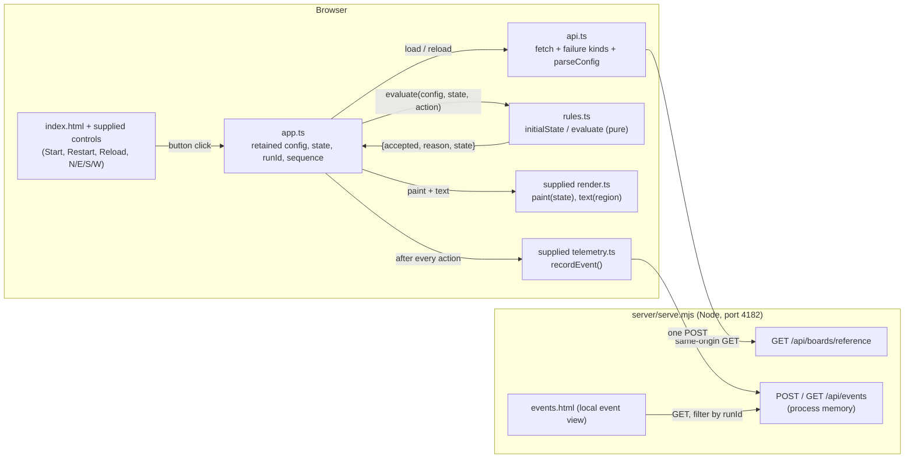

# Architecture: Playable TypeScript Treasure Hunt

One Node.js process serves the page, the game data API and a local event collector, all on the **same origin**
(`http://127.0.0.1:4182`). The browser runs the game. The server only supplies data and stores events.

## Request path

## Who owns what

| Part | File | Job | Owner |
|---|---|---|---|
| Genre choice | `src/genre.ts` | Picks the `treasure` route | Owned |
| Types | `src/models.ts` | `GameState`, `MoveAction`, `RuleResult`, `Status`, `Reason`, with invariants | Owned |
| Rules | `src/rules.ts` | `initialState`, `evaluate`, `isFinished`. Pure: no DOM, clock, random or I/O; never mutates input | Owned |
| Data request | `src/api.ts` | `loadConfig()`: GET, then HTTP / malformed JSON / unexpected definition as separate errors | Owned |
| Controller | `src/app.ts` | Load → start → dispatch → restart. Keeps the last verified config and the current state | Owned |
| Regression | `tests/learner.test.mjs` | Changed-input cases with hand-worked expected values | Owned |
| Buttons | `src/supplied/controls.ts` | Builds N/E/S/W, wires Start/Restart/Reload, `playable()` | Supplied |
| Display | `src/supplied/render.ts` | `paint()`, `text()`, `identify()` | Supplied |
| Config guard | `src/supplied/config.ts` | `parseConfig()` accepts only the fixed reference board | Supplied |
| Event helper | `src/supplied/telemetry.ts` | `newRunId()`, `recordEvent()` | Supplied |
| Server | `server/app.mjs`, `serve.mjs` | Page files, board API, collector, `/healthz`, fault flags | Supplied |
| Release | `tools/release.py` | Pack (runs the rule gate) and verify (SHA-256 inventory) | Supplied |

## The game rules (order matters)

1. Game already finished → rejected `GAME_COMPLETE`.
2. Not a valid move → rejected `INVALID_ACTION`.
3. Off the board → rejected `EDGE`.
4. Into the wall (1,1) → rejected `WALL`.
5. Otherwise move, pay 1 move, and collect t1 (+10) the first time only.
6. On the exit (2,2) holding every treasure → `won`. **This is checked before the loss**, so a win on the last move counts.
7. Otherwise, 0 moves left → `lost`.

A rejected action returns an equal but **separate** copy of the state, so nothing changes.

## Message regions (kept apart on purpose)

| Region | Shows | Example |
|---|---|---|
| `api` | Transport only | `Loading game data...`, `Game data verified: ...`, `Game data request failed: HTTP 503`, `Game data was malformed JSON`, `Unexpected game definition: ...` |
| `status` | Game status only | `Playing: ...`, `You won! ...`, `Out of moves: you lost. ...` |
| `result` | Last action | `Moved east`, `Rejected: WALL` |
| `telemetry` | Event recording | `Recorded locally` or `Local recording unavailable` |

A failed **reload** only changes `api`. The game in progress and its buttons stay as they were.

## Lifecycle

```mermaid
stateDiagram-v2
  [*] --> NoData: page load (Loading...)
  NoData --> Ready: data verified
  NoData --> NoData: HTTP / malformed / unexpected (shown in api)
  Ready --> Playing: Start (new runId, sequence 0)
  Playing --> Playing: move (accepted or rejected; event recorded)
  Playing --> Finished: won or lost (buttons disabled)
  Playing --> Playing: Restart (new runId)
  Finished --> Playing: Restart (new runId)
  Playing --> Playing: Reload fails (state kept)
```

## Source → artifact → process

| Layer | What it is | Identity |
|---|---|---|
| Source | This Git repo (`src/*.ts`, server, page) | Git commit |
| Artifact | `releases/playable-01/` from `tools/release.py pack` | `release.json` (SHA-256 of every file) |
| Process | `python3 releases/playable-01/serve.py` on port 4182 | `X-Lab-Release: playable-01` header on game data |

This is a **local** release. There is no container, Kubernetes or BP deployment here. Deployment through the
central GitOps repo is planned for later.
